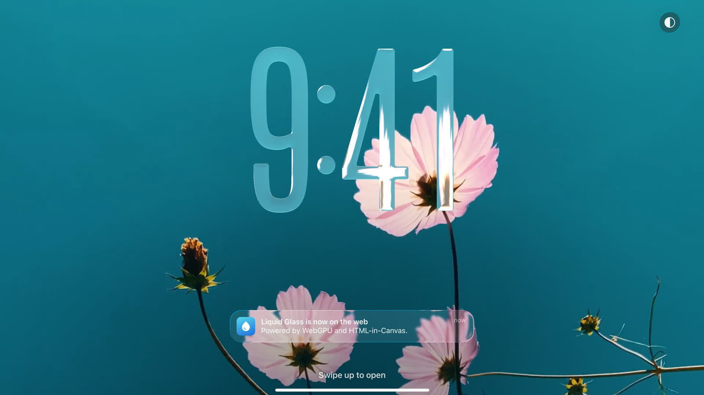
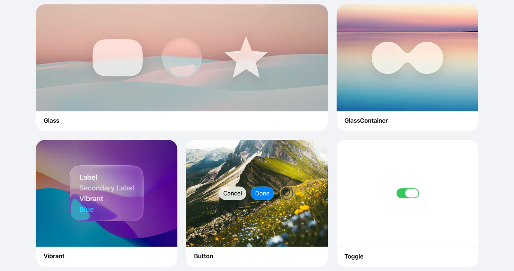
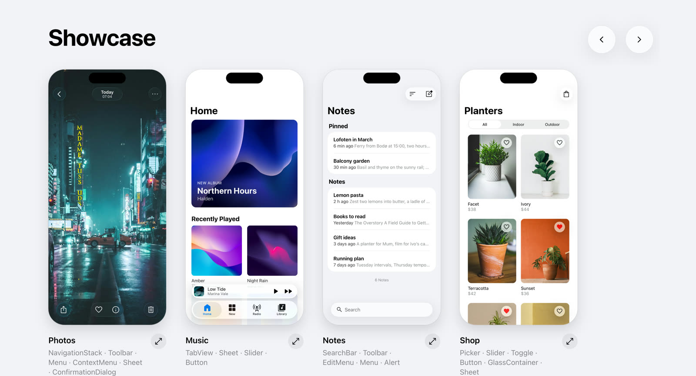

# Liquid Glass

Faithful Liquid Glass w/ WebGPU and HTML-in-Canvas.

> Experimental. APIs and visuals may change between 0.x releases.







```sh
npm install @robinwongm/liquid-glass
```

```tsx
import {GlassRoot, Glass} from '@robinwongm/liquid-glass';
import '@robinwongm/liquid-glass/style.css';

<GlassRoot>
  
  <Glass>Hello</Glass>
</GlassRoot>
```

## Known issues

- Chromium 157: an HTML-in-Canvas bug can leave parts of the page undrawn while scrolling. Fixed in 158.
- Every change redraws the whole `GlassRoot`, so scrolling a large one is slow. Wrap the area that has glass, not the whole page.

Chromium 157+. Apache-2.0. Not affiliated with Apple.
